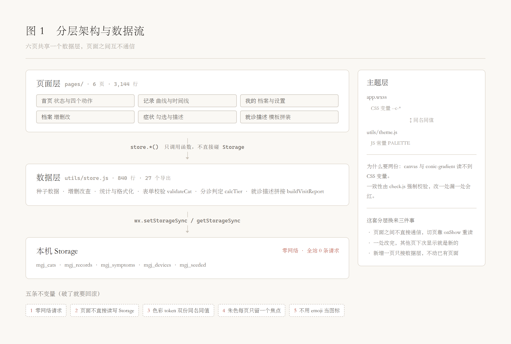
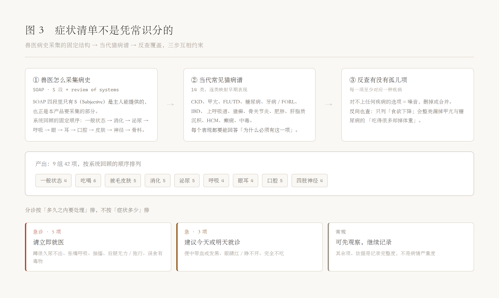
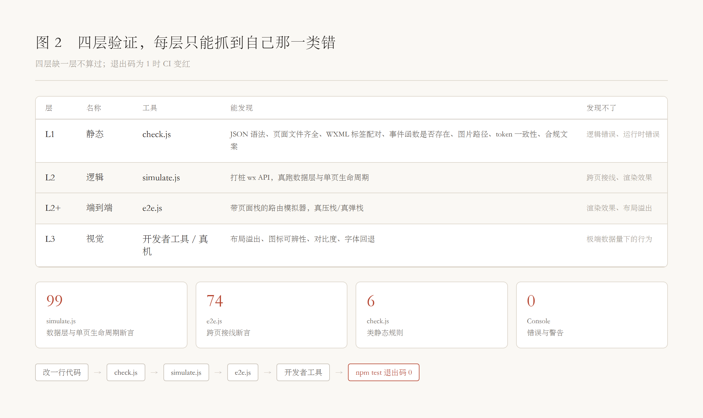

# 喵管家 · 课程报告

> 孙瑞阳　班级 1014　学号 2530031251
> 仓库：`github.com/4H1DSRY/workbuddy-miniprogram-homework`（**GitHub 公开仓库**，无需登录即可访问、克隆与复现全部测试）

---

## 摘要

喵管家是一个记录猫咪日常照顾的微信原生小程序：投食、喂水、逗猫、称重、记症状五个动作各点一下就完成，数据留在本机，不联网、不依赖任何第三方库。六页、约 5,000 行代码、245 条数据层与端到端断言。另有一套自建的 8 个技能，把《微信小程序设计指南》变成可执行的检查——包括一个真的抓到过我自己错误的脚本。

这份报告不复述功能。它回答四个问题：架构为什么这样分、设计规则为什么能守住、一个本来要做 AI 诊断的功能为什么被砍掉一半、以及**为什么测试全绿不等于没有问题**。

第四个问题的答案来自四次真实的翻车——每一次都是"每一页单看都对，连起来才错"。

---

## 一、问题与边界

### 1.1 出发点：一天 30 秒

养猫的日常摩擦不在"想知道猫怎么样"，而在"记不住"。今天喂了几次、喝了多少水、上次称重是哪天——这些事单看都微不足道，攒一周就变成"最近好像瘦了？"这种没有依据的直觉。

所以这个产品只有一个硬指标：**每天固定动作要在 30 秒内做完**。

这个约束是后面所有版面决策的来源。首页必须一屏装完五块内容（体重与趋势、今日照顾分、进食饮水逗猫三条刻度、一行心情自评、五个快捷动作），不能滚动——一滚动就会犹豫，一犹豫就会跳过一天。

### 1.2 四条明确不做的

这四条不是一开始就全定的。前两条在写第一行代码之前就确定了；后两条是被现实追加的——"不追求功能数量"在原型做完后被反复验证，"不做生成式 AI"则是在合规调研之后才被迫接受。

每一条都带代价。代价写进表里，不藏起来：一份只写"我要做什么"而不写"我为此放弃了什么"的范围说明，下次讨论时会被当成免费的。

| 不做 | 原因 | 代价 |
| --- | --- | --- |
| 云开发 / 后端 | Console 干净是作业硬要求；联网即引入不可控的失败面 | 换手机数据清零，需靠导出导入补 |
| 账号体系 | 单机单用户是明确边界，课程场景下无收益 | 无法多端同步 |
| 追求功能数量 | 现有页面已覆盖核心闭环，新功能必须先证明它减少了一次真实摩擦 | — |
| 生成式 AI | 个人主体做不了对应类目（第四章详述） | 头像只用主人自己拍的照片，不生成、不美化 |

---

## 二、架构

### 2.1 三层：页面、数据、存储

代码分成三层，读一次数据只走一条路：



六个页面共享一个数据层，**页面之间不直接通信**。切页时靠 `onShow` 重新读一遍数据，而不是靠上一个页面传值。这个选择让"一个页面改完，另一个页面显示的是旧值"这类问题在结构上不可能发生。

数据层 `utils/store.js` 承担的不只是增删改查，还有四类判断：

- **表单校验**（`validateCat`）：空名、超长名、体重 0 与 31 全部在这里拦。页面只负责把返回的 `msg` 显示出来。
- **参考量推导**（`foodTargetOf` / `waterTargetOf`）：进食与饮水的每日目标都由体重现算（`1.2 × 70 × W^0.75 ÷ 1.3 kcal/g`、`W × 50 ml/kg`），不再是档案里的输入项——规则只有一处实现，改体重当天生效。公式里的能量密度随粮型浮动，所以面板另留「自定义」覆盖入口（见 7.3）。
- **分诊判定**（`calcTier`）：症状组合与持续时间进，三档出。
- **文本生成**（`buildVisitReport`）：把已选症状拼成就诊描述。纯模板拼接，不调模型。

把判断放在数据层而不是页面里，好处是**同一套规则只有一处实现**，测试也只需要测一层。

### 2.2 五条不变量

以下五条是"破了就要回滚"的约束，不是建议：

| # | 不变量 | 为什么 | 谁守 |
| --- | --- | --- | --- |
| 1 | 零网络请求 | 联网即引入失败面，Console 干净无从保证 | `check.js` |
| 2 | 页面不直接读写 Storage | 单一数据源，改一处全局生效 | code review |
| 3 | 色彩 token 在 `app.wxss` 与 `theme.js` 双份同名同值 | **`canvas` 与 `conic-gradient` 读不到 CSS 变量**——这是微信小程序的限制，不是我的选择 | `check.js` 校验 |
| 4 | 朱色每页只留一个焦点 | 全站视觉秩序的唯一支点，多一个就散 | 人工核验 |
| 5 | 不用 emoji 当图标 | 跨平台渲染不一致，且风格不可控 | `check.js` |

第 3 条值得单独说。同一份配色要在两个地方定义，是架构上最丑的一处，但它不是可选的美化——体重折线图用 `canvas 2d` 画，照顾分环用 `conic-gradient` 画，这两者都拿不到 CSS 变量。既然必须重复，就让脚本强制它们一致：改一处漏一处，`check.js` 直接退出码 1。

### 2.3 零网络的账

选零网络换来的是：没有域名配置、没有请求超时、没有失败重试、没有后端成本，Console 天然干净。

付出的代价很具体：**换手机等于数据清零**。这一条被写进 backlog 作为 P1 待补项（导出 / 导入 JSON），而不是当成"以后再说"。架构决策如果不写清代价，下次讨论时会以为它是免费拿到的。

---

## 三、设计：纸墨朱

### 3.1 三层配色与"每页一个焦点"

| 层 | 取值 | 用途 |
| --- | --- | --- |
| 纸 | `#FAF8F4` / `#FFFFFF` | 底色与需要浮起的块 |
| 墨 | `#1E1B19` → `#C9C2B8`，六级灰阶 | 文字、线、图标 |
| 朱 | `#AE412D` | **每页只留一个焦点** |

配套四条硬规矩：不画阴影（分隔靠留白和 1rpx 发丝线）、圆角收口（卡片 8rpx，按钮 4rpx，没有胶囊）、控件不染色（开关与筛选全走墨色）、字体全宋体。

"每页一个焦点"是这套语言里最容易被破的一条。它的意思不是"少用红色"，而是**一页之内只有一处可以抢注意力**：首页是照顾分环，记录页是体重数字，编辑页没有。这条规则在第四章被现实逼着改写过一次。

### 3.2 字号：从 16 档收到 7 档

第一版每页各自定字号，做完四页一统计，全站有 **16 种不同的 `font-size`**。这不是设计，是每页独立决策的副产物。

收口后只剩 7 档：

| 档位 | 用途 |
| --- | --- |
| 24rpx | 注释、注脚 |
| 28rpx | 正文、标签 |
| 30rpx | 次级标题 |
| 34rpx | 小节标题 |
| 44rpx | 页面标题 |
| 68rpx | 猫名展示数字 |
| 92rpx | 体重展示数字 |

39 处字号归并进来，lint 规则 R1 从 42 条降到 2 条（剩下的两条是 68/92 两个展示数字，属于刻意例外）。

**这一步没做干净。** 28 与 30 之间只差 2rpx，在 1x 屏上几乎看不出区别，留着是因为几个标签挪到 28 会挤、挪到 34 会空。它们是这次收口的中间状态，下一步应该合并掉。

### 3.3 触控热区 88rpx

按微信设计指南，可点区域的短边不应小于 88rpx（44pt）。第一版有 10 处不达标——文字只有 24rpx 高，点在字边缘就没反应。

两种解法都用过：

- **伪元素外扩**：`::after` 撑出 88rpx 的透明层，视觉零变化。7 处用了这个。
- **容器撑满 + 伪元素画内容**：色块选择器改成 88rpx 容器，用 `::before` 在中间画 44rpx 的圆点——视觉是 44rpx，热区是 88rpx，不用给伪元素加 `pointer-events` 之类的补丁。

第二种更稳。`::after` 外扩依赖命中测试的边界行为，在 iOS 模拟器上验过，**Android 真机没验**——这一条至今挂在未验项里。

另外，tabBar 未选中项的对比度原来是 2.02:1，远低于 4.5:1 的下限。改成 `#736A62` 后是 4.99:1。

### 3.4 三态语义色与"朱"的冲突

这是本次设计里唯一一次**规则被现实推翻**。

健康记录功能需要三档提示：紧急 / 关注 / 正常。按原规则"朱是每页唯一焦点"，朱该给谁？

如果朱同时表示"焦点"和"紧急"，那首页的照顾分环和症状页的"请立即就医"就是同一个颜色——一个表示"这里值得看"，一个表示"马上送医院"。这两件事的紧迫程度差三个数量级，用同一个颜色是不负责任的。

最终的处理是**收窄朱的语义**：

| 语义 | 取值 | 对比度 |
| --- | --- | --- |
| 紧急 / 就医 | `#AE412D`（朱） | 4.82:1 |
| 关注 / 观察 | `#8F5418` | 5.74:1 |
| 正常 | `#4A443F`（墨） | 9.04:1 |

朱从此只表示"需要立刻处理"，"焦点"这件事交给墨阶——用字重和字号做层级，而不是用颜色。这个改动一次性影响了三页的视觉重心，但不改的话，新功能上线第一天就会出现"猫粮吃完了"和"猫可能尿闭"同一个颜色。

### 3.5 照片，而不是替身

需求的起点是"照片卡通化"。合规上做不了（见 4.1），于是退一步做了纯 CSS 几何猫：5 种主色 × 3 种配饰，零图片资源。这只猫最后被删掉了，原因不是技术——**替身画得再准，也不如主人自己拍的一张**。真猫照片到位后，几何形象只剩两个后果：档案页多一组没人填的表单，首页多一条没人走的渲染分支。

删掉之后，这一节只剩照片本身的两个约束。

**比例。** 槽位原本是 654×264rpx（2.48:1）的横幅，配 `aspectFill`。按宽度裁满，画面只剩中间 60%，猫的下巴和身子留在框外，截图里一眼能看出不对。改成 3:2（654×436rpx）配 `aspectFit`，一个像素都不裁；用户自己换的图比例不可控，那就在槽位里留边。**留边比切掉半张脸好。**

**圆角。** 12rpx（≈6pt）才看得出来。4rpx 在视网膜屏上只有 2–3 个物理像素被抗锯齿吃掉一半，等于没写。同一时期还修了心情格：1rpx 的描边在 @3x 上是 1.57 个物理像素，五个格子排在非整数位置上，四边被分摊的比例各不相同，最右一格看起来只有三条边。两处是同一类问题——**rpx 换算不到整数物理像素，小尺寸元素就会各自塌一边**。统一改成 2rpx / 12rpx 之后都干净了。

这段 CSS 全删了，但留下一个通用的坑：WXSS 里**类名没有作用域**。当时给形象色板写了 `.sw`，和首页切猫标签同名，lint 把首页那处也按色板的 44rpx 报错——规则不会报冲突，只会悄悄串味。

---

## 四、健康记录：一个被砍掉一半的功能

### 4.1 两个 AI 功能都过不了审

需求原话是"AI 诊断 + 照片卡通化形象"。做完合规调研后，两个都做不了：

| 功能 | 卡在哪 | 依据 |
| --- | --- | --- |
| AI 诊断 | 「宠物医院 / 兽医」「其他宠物健康服务」类目，个人主体不可从事 | 微信《小程序备案服务内容标识选择指引》 |
| AI 生图 | 「深度合成」类目仅企业主体可申请 | 平台类目规则；另需按《AI 生成合成内容标识办法》做双重标识 |

有一个区分必须先讲清：**技术上能做 ≠ 审核能过**。个人主体的云函数完全可以调大模型 API，代码跑得通，卡在提审环节。

也考虑过用规则引擎绕开大模型——不行。「在线问诊」是按**功能实质**判定的，不是按技术实现。填症状 → 出结论，即使规则是硬编码的，仍然属于问诊。绕开深度合成还有第二道关。

### 4.2 折中方案与三条红线

最终做的是「就诊描述生成器」：把主人观察到的症状整理成一段结构化文字，复制给兽医。形象这一半不做生成，直接用主人自己的照片。三条红线：

1. **不输出病名。** 全站禁用「诊断」「确诊」「疑似」。这条已固化成 `check.js` 的静态规则，改代码时会直接报错。
2. **输出物只能是事实陈述。** 报告页三段并列：勾选的症状 / 你描述的 / 持续多久。没有一句分析。
3. **免责文案必须跟着内容走。** 复制到剪贴板时，免责声明随正文一起复制——不能出现"文字被转发出去、声明留在原地"的情况。

这里有一处设计意图与合规口径的张力，得说清楚：**分诊判据用的是临床红旗项**（例如"蹲很久尿不出"），这实质上是按病情判的。但在文案上，输出只给**时间窗**（"请立即就医""建议今天或明天就诊""可先观察"），不给病情描述，也不给病名。判据可以重，措辞必须轻。

### 4.3 症状清单不是凭常识分的

第一版清单是按常识分了 5 组，做完之后被指出方向错了。重做的思路是三步：先弄清兽医实际怎么采集病史，再把它套到当代常见猫病谱上，最后反查有没有对不上任何疾病的孤儿项。



**第一步，兽医怎么采集病史。** SOAP 病历分四段（Subjective / Objective / Assessment / Plan），**只有 S 段是主人能提供的**，也正是本产品要采集的部分。再叠加系统回顾（review of systems）的固定顺序：一般状态 → 消化 → 泌尿 → 呼吸 → 眼 → 耳 → 口腔 → 皮肤 → 神经 → 骨科。分组顺序照此，只把眼与耳合并。

**第二步，当代常见猫病谱。** 14 类：CKD、甲亢、FLUTD、糖尿病、牙病 / FORL、IBD、上呼吸道感染、猫癣、骨关节炎、肥胖、肝脂质沉积、HCM、癫痫、中毒。每一类逐条映射早期表现。

**第三步，反查。** 每一项都必须能对应到至少一种疾病，否则是噪音。

凭常识分的那版漏了三整类，都很有代表性：

| 漏掉的 | 为什么必须补 |
| --- | --- |
| 食欲变好 / 总讨食 | 甲亢与糖尿病的典型表现恰恰是"吃得很多却掉体重"。只列"食欲下降"会整类漏掉 |
| 后腿无力 / 拖行 | HCM 动脉血栓（数小时内致死）与糖尿病神经病变的共同信号 |
| 理毛变少 / 毛乱 | CKD、甲亢、口腔疼痛都会让猫停止理毛。猫科特有，很容易被忽略 |

最终 9 组 42 项。这个推导过程的价值不在结论，而在**它把"我觉得该有哪些"换成了"文献里哪些必须有"**。

### 4.4 分诊按时间窗，不按症状多少

分诊（triage）排的是**多久之内要处理**，不是"哪个更严重"。

| 档 | 触发项 | 界面文案 |
| --- | --- | --- |
| 急诊（5 项） | 蹲很久尿不出、张嘴呼吸、抽搐、后腿无力 / 拖行、误食有毒物 | 请立即就医 |
| 急（3 项） | 便中带血或发黑、眼睛红 / 睁不开、完全不吃 | 建议今天或明天就诊 |
| 常规 | 其余 | 可先观察，继续记录 |

两个判据值得说明：

- **"蹲很久尿不出"排第一**，因为公猫尿道阻塞 24–48 小时可致死，是所有项里时间窗最短的。
- **"完全不吃"算急诊级**，因为肥胖猫禁食 2–3 天即可触发肝脂质沉积——这是猫特有、比狗危险得多的机制。

急诊项优先于持续时间单独判定：勾了一项急诊，无论持续时间选"1 天内"还是"更久"，结果都是"请立即就医"。

### 4.5 必须自陈的局限

- 引用的流行率是**人群数据**，不能用于个体判断。清单里出现某项，不代表猫得了对应疾病。
- 作者不是兽医。本文档只服务"该采集哪些观察项"，不产出鉴别诊断。
- 红旗项清单是**产品规则**，不等于临床分诊标准。实际紧急程度必须由执业兽医判断。
- 中国城市猫的疾病谱与欧美数据可能有差异（散养比例、疫苗覆盖率不同），后续宜用本地数据校准。

---

## 五、验证：四层，每层只能抓到自己那一类错

### 5.1 分层

验证手段分四层，每一层只能抓到自己那一类错：



四层的分工不是按"重要性"排的，是按**能发现什么**排的：静态检查抓结构，逻辑测试抓数据行为，端到端抓跨页接线，视觉检查抓布局。任何一层都替代不了另一层。

当前基线：`check.js` 6 类静态规则全过，`simulate.js` 171 项断言，`e2e.js` 74 项断言，开发者工具 0 错误 0 警告。三层脚本由 `npm test` 串起来，**任一层失败退出码为 1**，CI 靠这个判定。

其中 `e2e.js` 是后期才补的。它的核心是一层**页面栈路由模拟器**：`navigateTo` 真的压栈并跑 `onLoad(query) + onShow`，`navigateBack({delta})` 真的弹栈并触发上一页 `onShow`。有了它，"按返回键""点完成""从历史点进去"这些路径才算真的被测过。

### 5.2 四个"全绿但仍然错"的案例

这一节是这份报告里唯一值得别人借鉴的部分。

**案例一：布局溢出 186rpx（只有视觉层能抓）**

首页内容比视口高出 186rpx，四个动作的文字标签被切在屏幕外。`check.js` 全过、`simulate.js` 全过——因为它们不看像素。这个错误只有截图能发现。

教训：**涉及尺寸、间距、字号的改动，必须过截图**。

**案例二：提交按钮变死按钮（只有端到端能抓）**

在报告页按 Android 返回键（或 iOS 侧滑）退回症状页时，页面**不会重建**，只走 `onShow`。而为防连点加的 `submitting` 锁只在新页面进入时初始化，此时停在 `true`——勾选还在、按钮也在，按下去毫无反应。

单页测试永远测不出这个，因为每个用例都新建页面实例，锁永远是 `false`。

**案例三：记录完就消失（同一个测试抓出）**

症状日志写进了 Storage，但全站只有报告页读它，而报告页只能从"刚提交"这一条路径进入。复制完点"完成"，这条记录就再也找不到了——**一个叫"记录"的页面，不记录健康记录**。

补了记录页的"就诊描述"区块（最近 3 次，日期 + 短标签 + 摘要，点击重开报告页）才算闭环。

案例二和三是同一个测试同一次跑出来的。它们共同的形状是：**单页都对，拼起来才错**。

**案例四：跨零点归零（时间也是输入）**

种子数据的时间写的是 `now - 3H` 这类相对偏移。23:08 跑测试全过，00:03 再跑，最新一条记录落到"昨天"，首页"今日摄入"显示 0/200g，测试跟着挂。

同一份代码、同一台机器，只因为跑的时刻不同。改成按"今天已过去时段的百分比"铺开才解决。

教训：**凡是用 `Date.now()` 算出来的展示数据，都要问一句"零点附近还成立吗"**。

### 5.3 写进流程的三条

1. 布局问题只有截图能抓，动了尺寸就必须截图。
2. 页面之间的接线只有端到端能抓，加页面就必须加 e2e 用例。
3. **跑测试必须先看退出码**。曾经用管道过滤输出，进程崩溃前打印的 PASS 行照样显示，异常栈被吞掉，看起来像通过。

---

## 六、把设计指南做成技能

### 6.1 为什么不是"记住规范"

《微信小程序设计指南》是散文体。它说"避免误操作""反馈及时"，但不给判据。散文的问题不是不对，是**无法被判错**——写代码的人（或 AI）只要没想起来，就等于不存在。

第一版做完，四个页面自我感觉良好。真扫一遍是 16 / 26 分：10 处可点击区域低于 7mm、确认弹窗有两套朱色、字号散成 16 档。这些都不是审美问题，是没有尺子。

所以做的不是"读一遍指南"，而是把它转成**可执行的东西**：一条规则必须能回答"过 / 不过"才留下，回答不了的（"视觉层次是否舒适"这类）全部删掉。这个取舍决定了后面能不能自动化。

### 6.2 八个技能，两层

| 层 | 技能 | 内容 | 行数 |
| --- | --- | --- | --- |
| 总规则 | `wxmp-design-system` | 红线 7 条（字号阶梯 / 四档文字色 / Tab 数量 / 热区 88rpx / 单加载动画 / 胶囊避让 / 设计稿基准）+ 13 条判定规则 + 评分卡 + 分诊路由 | 102 |
| 实现 | `wxmp-visual-tokens` | 六档字号、文字色阶、10 色板、按钮三型三尺寸五状态 | 245 |
| 实现 | `wxmp-layout-adapt` | rpx 换算、375 与 390 两个基准不得混用、安全区、1px 细线 | 158 |
| 实现 | `wxmp-navigation` | 胶囊区 87×32 占位、页面栈语义、Tab 约束 | 161 |
| 实现 | `wxmp-weui-components` | 何时用官方组件、何时自绘 | 197 |
| 实现 | `wxmp-feedback` | 四档反馈决策表、加载三档、防泄漏加载计数器 | 159 |
| 领域 | `feline-disease-map` | 猫常见病谱与症状映射，用于反查清单覆盖度、识别反向表现 | 154 |
| 领域 | `veterinary-history-framework` | SOAP + 系统回顾 + 分诊，回答"该采集什么、什么算急" | 166 |

八个技能合计 1,342 行，全部放在用户级目录，跨项目复用；其中总规则层另带一个 233 行的扫描脚本 `wxmp_ui_audit.py`——它已随仓库发布（`tools/`），`python tools/wxmp_ui_audit.py miaoguanjia` 可复现下面所有结论。

两层拆分的理由是**上下文预算**：合成一个 1,300 行的单文件，每次调用都占满窗口，而一次改动通常只用到其中一节。总规则层只做判定和路由，细节下沉重到五个子技能。

两个领域技能解决的是另一类问题——第四章的症状清单。它不能靠常识分组：像"食欲变好"这种反向表现，只有对着疾病谱反查才想得到。

### 6.3 它实际产出了什么

10 月 21 日 11:34 建完六个 wxmp 技能，当天下午用它扫全项目，出两份文档：

- 《诊断-微信设计规范》218 行：逐条给"位置 + 构成 + 估算尺寸 + 判定"，总分 16 / 26。只诊断，未动一行源码。
- 《改进方案》420 行：把 P0 / P1 逐条对应到文件行号与改法。

然后才是改代码：字号从 16 档收到 7 档（39 处）、可点击区域补到 88rpx、确认色从两套并成一套、三态语义色重新取值。

第二天（10/22 14:33）建两个领域技能，用来做症状清单的分组与分诊时间窗。

顺序是**先出诊断，再改代码**。这让"改了什么、为什么改"有据可查，而不是改完再补理由。

### 6.4 最硬的一条证据：脚本抓到了我自己

技能不只装知识，还装脚本。`wxmp_ui_audit.py` 扫 wxss / wxml，按红线输出 BLOCK / WARN / INFO，退出码可直接进 CI。

写这份报告前一天，我给首页加了心情自评——五个格子，热区写的是 `44rpx`。心里想的是 44px，手上写的是 rpx，**差了一倍**。

三套测试全绿：`check.js` 查结构、`simulate.js` 查数据、`e2e.js` 查接线，没有一层看尺寸。报告里"触控热区 88rpx"这句话也仍然成立——它说的是别处。只有那个脚本报了：

```
| BLOCK | R4 | index.wxml:81 | 可点击元素 .mood-cell 尺寸 44rpx 小于 88rpx / 44px / 7mm |
```

同一轮它还翻出一件更早的事：顶栏切猫与"＋"的热区，是靠 `<text>::after` 撑的 88rpx——而伪元素画在 `<text>` 上微信渲染层不生效。那两处热区扩展**从落地那天起就是空的**，实际只有 24–28rpx 高。改法是把热区移到 `<view>` 上承载，再用负边距把多出来的一半高度挂到行外，顶栏高度不变。

这两条就是这一节的全部理由：**规范和脚本的区别，是"知道"和"能查出来"。**

### 6.5 技能的边界

- 它能判"是否合规"，不能判"是否正确"。第五章那四个"全绿但仍然错"的案例，全都合规。
- 16 / 26 是合规分，不是好用分。它不会告诉你首页该放几个入口——那个判断来自用户第一句反馈。
- 规则漏的它也漏。剩下 2 条 WARN 是 68rpx 与 92rpx 的展示字号，我判定为可接受偏离并写在这里，而不是改掉：规则服务可读性，不服务数字整齐。

---

## 七、复盘

### 7.1 两次方向性纠正

**第一次：症状清单凭常识分。**

第一版分 5 组，看起来合理，实际上漏掉了"食欲变好"这类反向表现。纠正的方向是给方法：先参照真实的初步诊疗评价体系，再收集当代常见猫疾病，按这两步重做。

**第二次：功能入口藏在页面最底部。**

入口放在记录页 footer 上方，理由是"首页一屏只剩 52rpx 余量，低频功能不该占首页"。这个判断在自用场景下成立，在**演示场景**下不成立——第一眼看不到就等于没有。

两次的形状是一样的：**我做的东西技术上没错，但没对准真实问题**。共同特征是决策依据来自"我以为"，而不是"使用者怎么走"。

### 7.2 AI 协作的边界

这个项目全程由 AI 执行代码，但边界很清楚：

**能交出去的**：批量改写（39 处字号归并）、断言编写、文档与代码对齐、截图取证、把一次性的排查脚本固化成 CI 里的一层。

**不能交出去的**：判断"这个功能该不该做"、判断"这个位置对不对"、判断"这个数字能不能信"。

一个具体的例子：当时的 108 项断言是我自己写的，全部通过，仍然漏掉了"死按钮"——因为断言只覆盖**我想到的路径**。后来补的 e2e 之所以有效，不是因为断言更多，而是因为它的**结构**迫使每一条路径都被走一遍（压栈、弹栈、触发上一页的 `onShow`）。换结构比加数量有用。

**同一类毛病的第二次：一个不衰减的计数器被当成了度量。**

首页第三条刻度原本是"心情"。它的实现是：建档时写死一个数（82 / 64 / 90），每次逗猫 +14，上限 100，**永不衰减**。逗两次就封顶，之后永远是 100。它不是任何东西的测量结果，而是"建档那天的印象 + 点过几次按钮"。

麻烦在于它占"今日照顾分"的三分之一：今天什么都没喂，照顾分仍然有 27 分保底。而它和前两条长得完全一样——同样的轨、同样的长度、同样 24rpx 的数值，只是前两条后面写着 `g` 和 `ml`，它后面什么都没有。一个没有单位的数字，和两个有单位的数字排成一行，语义上却差着一个数量级。

纠正来自一句提问："心情真的是一个可以量化的东西吗？"改法没有删功能：第三项换成**逗猫分钟数**（记录里本来就有这个值，只是没拿来算分）；心情另起一行做 **1–5 自评**，并明确**不进入照顾分**。照顾分算的是"你做了什么"，自评记的是"你看到什么"，两件事不该折进同一个百分比。

这也是"判断这个数字能不能信"不能交出去的原因：AI 会造出形状正确、语义为空的数字，而它在截图里看起来毫无破绽。

### 7.3 一个手填的数字，被当成了参考量

首页三条刻度都有分母。第三条（逗猫）的分母 30 分钟是写死的，这没问题——逗多久取决于人，与猫的大小无关。前两条则是错的。

第一版的做法：进食目标让主人建档时自己填，三个种子值 160 / 200 / 220 g（新建时默认 180），凭印象挑一个；饮水目标更省事，`进食 + 60`。于是界面上那句「160 / 200 g」——分子来自今天的记录，分母来自建档那天的印象，两个数用同样的字号、同样的单位排在一起，可信度差着一个量级。

固定偏移的毛病是可以算出来的。芝麻 3.18 kg，旧目标 220 ml，折合 **69 ml/kg**；NRC 给猫的参考区间是 44–66，超了 15%。团子 4.62 kg 是 56 ml/kg，合规。也就是说"全都 +60"这个规则对重猫勉强成立、对轻猫必然越界——它加的是绝对量，而体重差的是比例。

改法是把两个数都从体重推：`RER = 70 × W^0.75`，绝育成猫 `DER = 1.2 × RER`，除以 1.3 kcal/g 折成克；饮水取 50 ml/kg（区间中位）。三只猫变成 **200 / 150 / 220 g** 与 **230 / 160 / 250 ml**，饮水全部落回区间。档案里那个输入框随之删掉，改体重当天生效。

但这一步做完，另一个问题浮出来：**1.3 kcal/g 是折中，不是常数**。干粮 3.5–4.5 kcal/g，主食罐 0.8–1.2，同一只 4.62 kg 的猫按干粮算 66 g、按罐头算 265 g，差四倍——公式给的 200 g 只对"罐为主、掺少量干粮"这一种喂法成立。

所以最终形态不是一个更准的公式，而是**公式给起点、人给实际**：面板档位行末加一格「自定义」，手填的数只要不在档位表里就自动反白，写进记录的就是填的那个数。参考量退回到它该在的位置——提示，不是红线；超了只告知，不拦。

这条和 7.2 那个计数器是同一类错误的两面：一个只涨不跌，一个只对一种喂法成立。**空着的数字人人警惕，形状正确的数字没人怀疑**——界面给它配上单位、轨道和百分比，它看起来就像是被量出来的。

改完之后补了反向验证：把两个函数改回写死 200 / 260 再跑，8 条与公式相关的断言立刻全红。这一层在旧实现上不存在，因为旧实现根本没有"按体重算"这回事。

---

## 八、后续

| 优先级 | 事项 | 状态 |
| --- | --- | --- |
| P0 | 真猫照片（已换 Pexels 授权图）、录屏、本报告 | 照片 ✅，录屏待拍 |
| P1 | 数据导出 / 导入（零网络的对价） | 未开始 |
| P1 | 记录可编辑 / 删除 | 未开始 |
| P2 | 症状分组可导航性测试（5 个场景卡首点正确率 ≥70%） | 待找人实测 |
| P2 | 合并 28 / 30 两个过近的字号档 | 未开始 |
| — | Android 真机验证（伪元素热区的命中测试、宋体回退） | 未验 |

---

## 附录 A　文件与规模

| 部分 | 规模 |
| --- | --- |
| 页面 6 个（首页 / 记录 / 我的 / 档案 / 症状 / 就诊描述） | 3,702 行 |
| 数据层 `utils/store.js` | 1,062 行，49 个导出 |
| 主题层 `utils/theme.js` + `app.wxss` | 291 行 |
| 静态检查 `check.js` | 6 类规则 |
| 逻辑断言 `simulate.js` | 171 项 |
| 端到端断言 `e2e.js` | 74 项 |
| 自建技能 `~/.workbuddy/skills/` | 8 个 / 1,342 行 + 1 个审计脚本 |

## 附录 B　术语

| 词 | 含义 |
| --- | --- |
| SOAP | 兽医病历的四段结构：Subjective / Objective / Assessment / Plan |
| 系统回顾 | 按身体系统逐项问诊的固定顺序 |
| 分诊（triage） | 按"多久之内要处理"排序，而非按严重程度 |
| 红旗项 | 提示需要立即处理的少数症状 |
| 不变量 | 破了就要回滚的架构约束 |

## 附录 C　数据来源

报告中的流行率、体系结构与平台规则来自以下来源。刻意区分一手与二手：前者可复核，后者只能作为**量级**参考，不能用来支撑任何精确判断。

| 内容 | 来源 | 类型 |
| --- | --- | --- |
| CKD 患病率 1.2% / >9 岁 3.6% / 15 岁 >80% | petadoptnow 汇总 | 二手科普 |
| 甲亢 >9 岁 11.4%、FLUTD 约 4%、糖尿病 0.5–1%、牙病 70%/80%、FORL 60%、肥胖约 60% | RSPCA、petadoptnow 等，多家口径一致 | 二手科普 |
| 关节炎 35.9%、甲亢 13.9%、牙病 31.3% | PMC7557453《Prevalence of Disease and Age-Related Behavioural Changes in Cats》 | 一手文献 |
| SOAP 结构与系统回顾顺序 | 兽医病历书写规范（AVMA 记录标准相关材料） | 体系性来源 |
| 宠物类目对个人主体的限制 | 微信《小程序备案服务内容标识选择指引》 | 平台规则 |
| AI 生成内容标识要求 | 《人工智能生成合成内容标识办法》（2025-09-01 施行） | 法规 |

> 中国城市猫的疾病谱与上述欧美数据可能存在差异（散养比例、疫苗覆盖率、就诊率均不同）。这些数字用于确定"该问哪些问题"，不用于判断任何一只具体的猫。
